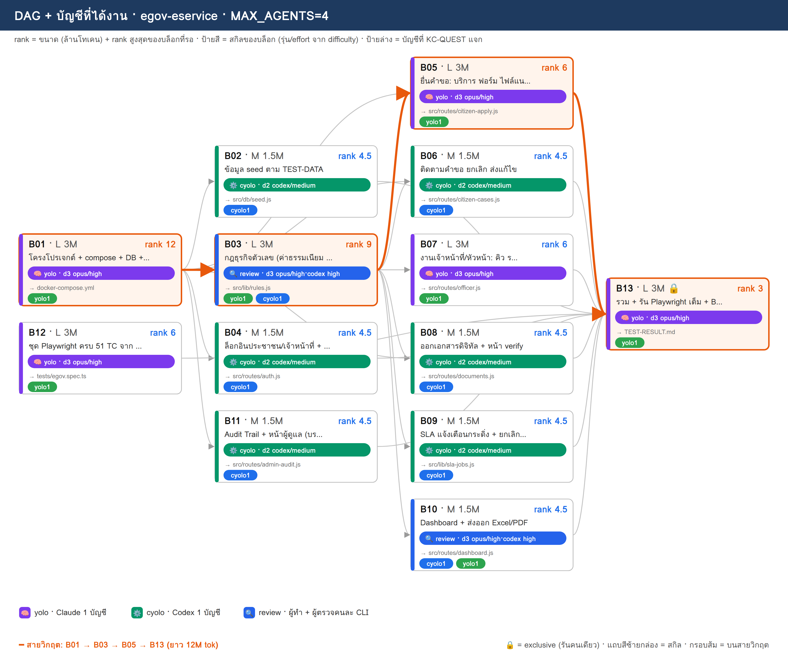
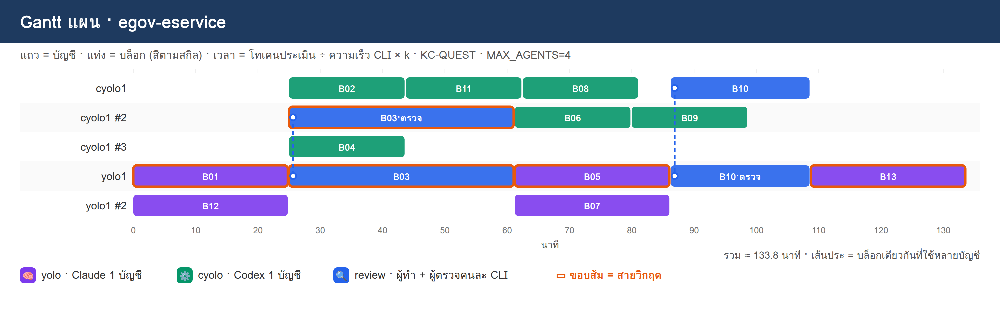

# PLAN · egov-eservice

**โจทย์:** สร้างเว็บ e-Service กลางตามชุดโจทย์ใน /workspace/egov-brief (อ่าน README.md ก่อน) ต้องทำตาม REQUIREMENTS.md CONTRACT.md TEST-DATA.md DECISIONS.md ครบทุกข้อ รันด้วย Docker Compose คำสั่งเดียว รองรับ TEST_MODE=1 และ BUG_MODE ตาม BUGS.md และมีชุด Playwright ครบทุก TC ใน TEST-PLAN.md · stack: Node.js 20 + Express + better-sqlite3 + EJS (server-rendered) · ทุกบล็อกเขียนเฉพาะไฟล์ของตัวเองตาม path ที่ระบุ · path ทุกไฟล์สัมพัทธ์กับโฟลเดอร์งาน (cwd) ของบล็อก

วางแผนเมื่อ 15/11/2026 13:42 · MAX_AGENTS 4 · บัญชี cyolo1, yolo1 · ตัวปรับเวลา k (ยังไม่มี calib.json → k=1)

> แผนนี้ยังไม่ได้รันจริง — KC-QUEST เลือกบัญชีจากโควตา แล้วจำลองเวลาตาม dependency

## 1) โควตาของแต่ละบัญชี

| บัญชี | แพลน | ใช้ไป 5 ชม. | ใช้ไปสัปดาห์ | headroom | รีเซ็ต/หมดอายุ (ชม.) | U | slot | ที่มา |
|---|---|---|---|---|---|---|---|---|
| cyolo1 | free | 0% | 1% | **99%** | 620.7 | 0.037 | 3 | team.py quota |
| yolo1 | default | 8% | 23% | **77%** | 71.3 | 0.252 | 3 | team.py quota |

## 2) DAG + สกิล + บัญชี

**สายวิกฤต:** B01 → B03 → B05 → B13 · ยาว 12M tok

## 3) ตารางแจกงาน (เหตุผล KC-QUEST ทุกบล็อก)

| บล็อก | สกิล | ชื่อ | ขนาด · c | รอ | rank | บัญชี (บทบาท) | เริ่ม–จบ (นาที) | เหตุผล KC-QUEST |
|---|---|---|---|---|---|---|---|---|
| **B01** | 🧠 yolo | โครงโปรเจกต์ + compose + DB + test hook | L · 3 | – | 12 | yolo1 (ทำ) | 0.0–25.0 | ทำ: yolo1 38.0 (U=0.252 F=0.013 S=0.842 S=1.0 L=0.0) · 3.00M ≈ 5ชม. 7.8% / สัปดาห์ 0.98% |
| B12 | 🧠 yolo | ชุด Playwright ครบ 51 TC จาก TEST-PLAN | L · 3 | – | 6 | yolo1 (ทำ) | 0.0–25.0 | ทำ: yolo1 26.0 (U=0.252 F=0.013 S=0.764 S=0.5 L=0.333) · 3.00M ≈ 5ชม. 7.8% / สัปดาห์ 0.98% |
| **B03** | 🔍 review | กฎธุรกิจตัวเลข (ค่าธรรมเนียม · SLA · เตือน · เลขคำขอ) | L · 3 | B01 | 9 | yolo1 (ทำ), cyolo1 (ตรวจ) | 25.0–61.2 | ทำ: yolo1 31.9 (U=0.252 F=0.013 S=0.686 S=0.75 L=0.0) · 3.00M ≈ 5ชม. 7.8% / สัปดาห์ 0.98%   ตรวจ: cyolo1 24.1 (U=0.037 F=0.003 S=0.977 S=0.525 L=0.0) · 0.90M ≈ 5ชม. 2.34% / สัปดาห์ 0.29% |
| B02 | ⚙️ cyolo | ข้อมูล seed ตาม TEST-DATA | M · 1.5 | B01 | 4.5 | cyolo1 (ทำ) | 25.0–43.8 | ทำ: cyolo1 16.2 (U=0.037 F=0.005 S=0.938 S=0.262 L=0.333) · 1.50M ≈ 5ชม. 3.9% / สัปดาห์ 0.49% |
| B04 | ⚙️ cyolo | ล็อกอินประชาชน/เจ้าหน้าที่ + ลงทะเบียน + สิทธิ์ตามบทบาท | M · 1.5 | B01 | 4.5 | cyolo1 (ทำ) | 25.0–43.8 | ทำ: cyolo1 12.3 (U=0.037 F=0.005 S=0.899 S=0.262 L=0.667) · 1.50M ≈ 5ชม. 3.9% / สัปดาห์ 0.49% |
| B11 | ⚙️ cyolo | Audit Trail + หน้าผู้ดูแล (บริการ วันหยุด ผู้ใช้) | M · 1.5 | B01 | 4.5 | cyolo1 (ทำ) | 43.8–62.5 | ทำ: cyolo1 15.1 (U=0.037 F=0.005 S=0.86 S=0.262 L=0.333) · 1.50M ≈ 5ชม. 3.9% / สัปดาห์ 0.49% |
| **B05** | 🧠 yolo | ยื่นคำขอ: บริการ ฟอร์ม ไฟล์แนบ ร่าง ชำระ QR | L · 3 | B01, B03 | 6 | yolo1 (ทำ) | 61.2–86.2 | ทำ: yolo1 27.0 (U=0.252 F=0.013 S=0.608 S=0.5 L=0.0) · 3.00M ≈ 5ชม. 7.8% / สัปดาห์ 0.98% |
| B07 | 🧠 yolo | งานเจ้าหน้าที่/หัวหน้า: คิว รับ ตีกลับ ส่งต่อ อนุมัติ ปกป้องเลขบัตร | L · 3 | B01, B03 | 6 | yolo1 (ทำ) | 61.2–86.2 | ทำ: yolo1 22.5 (U=0.252 F=0.013 S=0.53 S=0.5 L=0.333) · 3.00M ≈ 5ชม. 7.8% / สัปดาห์ 0.98% |
| B06 | ⚙️ cyolo | ติดตามคำขอ ยกเลิก ส่งแก้ไข | M · 1.5 | B01, B03 | 4.5 | cyolo1 (ทำ) | 61.2–80.0 | ทำ: cyolo1 14.5 (U=0.037 F=0.005 S=0.821 S=0.262 L=0.333) · 1.50M ≈ 5ชม. 3.9% / สัปดาห์ 0.49% |
| B08 | ⚙️ cyolo | ออกเอกสารดิจิทัล + หน้า verify | M · 1.5 | B01, B03 | 4.5 | cyolo1 (ทำ) | 62.5–81.2 | ทำ: cyolo1 13.9 (U=0.037 F=0.005 S=0.782 S=0.262 L=0.333) · 1.50M ≈ 5ชม. 3.9% / สัปดาห์ 0.49% |
| B09 | ⚙️ cyolo | SLA แจ้งเตือนกระดิ่ง + ยกเลิกอัตโนมัติ | M · 1.5 | B03 | 4.5 | cyolo1 (ทำ) | 80.0–98.8 | ทำ: cyolo1 13.3 (U=0.037 F=0.005 S=0.743 S=0.262 L=0.333) · 1.50M ≈ 5ชม. 3.9% / สัปดาห์ 0.49% |
| B10 | 🔍 review | Dashboard + ส่งออก Excel/PDF | M · 1.5 | B03 | 4.5 | cyolo1 (ทำ), yolo1 (ตรวจ) | 86.2–108.8 | ทำ: cyolo1 12.7 (U=0.037 F=0.005 S=0.704 S=0.262 L=0.333) · 1.50M ≈ 5ชม. 3.9% / สัปดาห์ 0.49%   ตรวจ: yolo1 23.5 (U=0.252 F=0.002 S=0.518 S=0.375 L=0.0) · 0.45M ≈ 5ชม. 1.17% / สัปดาห์ 0.15% |
| **B13** | 🧠 yolo | รวม + รัน Playwright เต็ม + BUG_MODE ทีละตัว | L · 3 | B02, B04, B05, B06, B07, B08, B09, B10, B11, B12 | 3 | yolo1 (ทำ) | 108.8–133.8 | ทำ: yolo1 20.7 (U=0.252 F=0.014 S=0.44 S=0.25 L=0.0) · 3.00M ≈ 5ชม. 7.8% / สัปดาห์ 0.98% |

## 4) Gantt แผน

## 5) รอบแจกงาน

| นาทีที่ | บล็อกที่เริ่ม |
|---|---|
| 0 | B01→yolo1, B12→yolo1 |
| 25 | B03→yolo1+cyolo1, B02→cyolo1, B04→cyolo1 |
| 43.8 | B11→cyolo1 |
| 61.2 | B05→yolo1, B07→yolo1, B06→cyolo1 |
| 62.5 | B08→cyolo1 |
| 80 | B09→cyolo1 |
| 86.2 | B10→cyolo1+yolo1 |
| 108.8 | B13→yolo1 |

## 6) สรุป

- บล็อก 13 · แจกได้ 13 · agent พร้อมกันสูงสุด 4/4
- เวลาประมาณ 133.8 นาที (แท่ง Gantt) · ไฟล์ผลของทีม: `/workspace/plans/egov-eservice/app/`

ต่อไป: `dagplan.py export egov-eservice` → `dagplan.py run egov-eservice` → `dagplan.py report egov-eservice`
