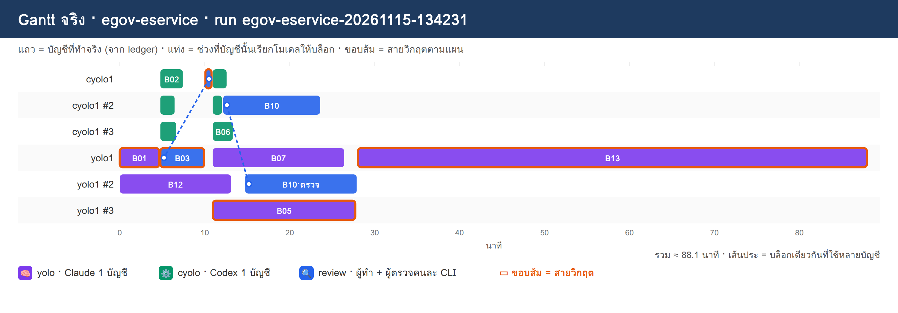
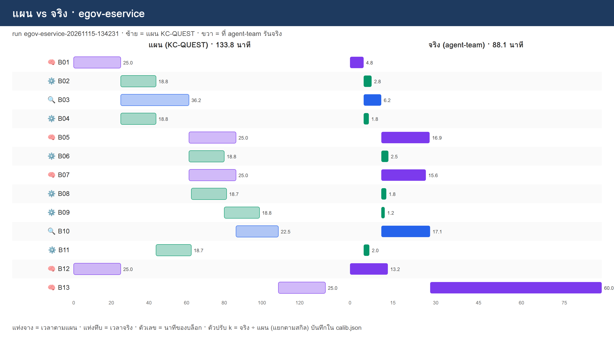

# REPORT · egov-eservice

**run:** `egov-eservice-20261115-134231` · `/workspace/.agent-team/egov-eservice-20261115-134231` · โจทย์: สร้างเว็บ e-Service กลางตามชุดโจทย์ใน /workspace/egov-brief (อ่าน README.md ก่อน) ต้องทำตาม REQUIREMENTS.md CONTRACT.md TEST-DATA.md DECISIONS.md ครบทุกข้อ รันด้วย Docker Compose คำสั่งเดียว รองรับ TEST_MODE=1 และ BUG_MODE ตาม BUGS.md และมีชุด Playwright ครบทุก TC ใน TEST-PLAN.md · stack: Node.js 20 + Express + better-sqlite3 + EJS (server-rendered) · ทุกบล็อกเขียนเฉพาะไฟล์ของตัวเองตาม path ที่ระบุ · path ทุกไฟล์สัมพัทธ์กับโฟลเดอร์งาน (cwd) ของบล็อก

## ตารางบล็อก (แผน vs จริง)

| บล็อก | สกิล | บัญชีแผน | บัญชีจริง | นาทีแผน | นาทีจริง | tokens (ไม่รวม cache read) | ครั้ง | สถานะ | ไฟล์ผล |
|---|---|---|---|---|---|---|---|---|---|
| **B01** | 🧠 yolo | yolo1(ทำ) | yolo1(ทำ) | 25.00 | 4.78 | 36,408 | 1 | ok | ✅ docker-compose.yml |
| B02 | ⚙️ cyolo | cyolo1(ทำ) | cyolo1(ทำ) | 18.75 | 2.78 | 58,936 | 1 | ok | ✅ src/db/seed.js |
| **B03** | 🔍 review | yolo1(ทำ), cyolo1(ตรวจ) | yolo1(ทำ), cyolo1(ตรวจ) | 36.25 | 6.17 | 222,567 | 2 | ok | ✅ src/lib/rules.js |
| B04 | ⚙️ cyolo | cyolo1(ทำ) | cyolo1(ทำ) | 18.75 | 1.82 | 48,159 | 1 | ok | ✅ src/routes/auth.js |
| **B05** | 🧠 yolo | yolo1(ทำ) | yolo1(ทำ) | 25.00 | 16.90 | 284,705 | 1 | ok | ✅ src/routes/citizen-apply.js |
| B06 | ⚙️ cyolo | cyolo1(ทำ) | cyolo1(ทำ) | 18.75 | 2.48 | 51,659 | 1 | ok | ✅ src/routes/citizen-cases.js |
| B07 | 🧠 yolo | yolo1(ทำ) | yolo1(ทำ) | 25.00 | 15.60 | 305,646 | 1 | ok | ✅ src/routes/officer.js |
| B08 | ⚙️ cyolo | cyolo1(ทำ) | cyolo1(ทำ) | 18.75 | 1.77 | 44,290 | 1 | ok | ✅ src/routes/documents.js |
| B09 | ⚙️ cyolo | cyolo1(ทำ) | cyolo1(ทำ) | 18.75 | 1.22 | 43,831 | 1 | ok | ✅ src/lib/sla-jobs.js |
| B10 | 🔍 review | cyolo1(ทำ), yolo1(ตรวจ) | cyolo1(ทำ), yolo1(ตรวจ) | 22.50 | 17.07 | 171,552 | 4 | ok | ✅ src/routes/dashboard.js |
| B11 | ⚙️ cyolo | cyolo1(ทำ) | cyolo1(ทำ) | 18.75 | 2.00 | 40,560 | 1 | ok | ✅ src/routes/admin-audit.js |
| B12 | 🧠 yolo | yolo1(ทำ) | yolo1(ทำ) | 25.00 | 13.25 | 342,829 | 1 | ok | ✅ tests/egov.spec.ts |
| **B13** | 🧠 yolo | yolo1(ทำ) | yolo1(ทำ) | 25.00 | 60.03 | 535,748 | 1 | failed — timeout after 3600s | ❌ TEST-RESULT.md |

- tokens รวมของบล็อก **2,186,890** = ผลรวมจาก ledger ของ run (17 การเรียก) **2,186,890** ✅ ตรงกัน
- การเรียกที่ไม่ใช่บล็อก (ตรวจความพร้อม ฯลฯ): 0 ครั้ง · 0 tokens (ไม่นับในตาราง)
- เวลารวม: แผน 133.8 นาที · จริง 88.1 นาที
- บล็อกเสร็จ 12/13

## ภาพ

## ความต่างระหว่างแผนกับของจริง

- บัญชีจริงตรงกับแผนทุกบล็อก
- (export ส่งเป็นฝั่ง yolo/cyolo ไม่ผูกบัญชี เพื่อให้ failover ของ agent-team ทำงาน → agent-team เลือกบัญชีในฝั่งเองตามโหลด/โควตา ดู references/run.md)

## ตัวปรับเวลา k (calib.json)

`/workspace/plans/calib.json`: {"yolo": 0.5053, "cyolo": 0.1073, "review": 0.3954}

k = นาทีจริง ÷ นาทีแผน (ก่อนคูณ k) แยกตามสกิล · `plan` ครั้งถัดไปคูณเวลาแต่ละบล็อกด้วย k ของสกิลนั้น
